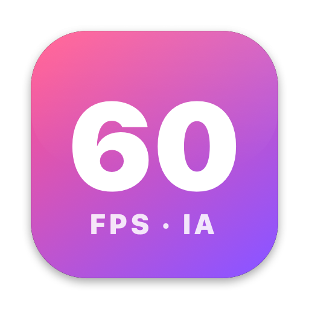
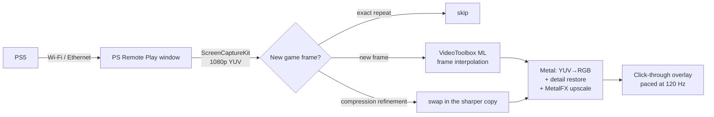

<p align="center">
  
</p>

<h1 align="center">RemotePlay 60</h1>

<p align="center">
  <b>AI frame generation for PS Remote Play on Mac: turn 30 fps PS5 games into 60 or 120 fps.</b><br>
  On-device machine-learning frame interpolation + MetalFX upscaling for Apple Silicon. No capture card, no Windows, no NVIDIA GPU.
</p>

<p align="center">
  
  
  
  
</p>

---

**RemotePlay 60** is a free, open-source macOS app that makes games streamed with **PS Remote Play** look smoother. It reads the Remote Play window with ScreenCaptureKit, works out which frames are actually new game frames, and generates the in-between frames with **Apple's machine-learning frame interpolation** (VideoToolbox `VTLowLatencyFrameInterpolation`, running on the Neural Engine and GPU). The result is drawn in a click-through overlay at up to **120 Hz on ProMotion displays**.

It was built to play **GTA VI (GTA 6) at 60 fps on a MacBook** through PS Remote Play, and it works with any PS5 or PS4 game you stream. If you have been looking for **Lossless Scaling or frame generation on macOS**, this project does the same job using Apple's built-in APIs.

- [Features](#features)
- [How it works](#how-it-works)
- [Modes and measured latency](#modes-and-measured-latency)
- [Requirements](#requirements)
- [Install and build](#install-and-build)
- [Usage](#usage)
- [Uninstall](#uninstall)
- [FAQ](#faq)
- [Português](#português)

## Features

- **AI frame generation 2x / 4x**: 30 → 60 fps or 30 → 120 fps, using Apple's on-device ML interpolator.
- **120 fps on ProMotion**: uses the full refresh rate of MacBook Pro displays.
- **Smart new-frame detection**: Remote Play sends 60 fps even when the game runs at 30 fps, so every game frame arrives twice: once as a new frame and once as a slightly sharper compression *refinement* of the same image. RemotePlay 60 tells these apart, so it interpolates between real game frames and always displays the sharper copy.
- **Sharp HUD at low cost**: in the fast modes the AI runs at 720p (about 3× faster), and a Metal shader puts the 1080p detail back wherever the image is still, so text, HUD and static scenery stay sharp.
- **MetalFX upscaling**: scales the 1080p stream to your Retina resolution with Apple's MetalFX spatial scaler.
- **Adaptive frame pacing**: each frame is shown at its target time on a 120 Hz display link, and the latency budget adjusts to measured network jitter.
- **Your controller keeps working**: the overlay never takes focus and lets every click through, so PS Remote Play stays the active app.
- **Leaves nothing behind**: no drivers, kernel extensions or Homebrew, and PS Remote Play itself is not modified. Settings are saved inside the app bundle, so deleting the app uninstalls it completely.

## How it works



1. **Capture**: ScreenCaptureKit captures only the PS Remote Play window, cropped to the 16:9 video area, which is found automatically from where the image moves.
2. **Classify**: each captured frame is compared with the previous one on a luma sample grid. Exact repeats (Remote Play redrawing at 120 Hz) are skipped. Small changes right after a new frame are compression refinements, so the sharper copy replaces the one waiting to be shown.
3. **Interpolate**: for every pair of real game frames, VideoToolbox generates frames at phase 0.5 (2x) or at 0.25, 0.5 and 0.75 (4x).
4. **Present**: frames are queued with timestamps and shown by a `CADisplayLink`. The delay is set from the measured worst case, so generated frames arrive on time.

## Modes and measured latency

Measured on a MacBook Pro (M4 Pro, 120 Hz) with a 1080p / 60 fps Remote Play stream of a 30 fps game:

| Mode | Output | AI cost per game frame | Added latency* |
|---|---|---|---|
| **120 fps · Max smoothness** | 30 → 120 fps | ~13 ms (720p, 3 frames) | ~+49 ms |
| **60 fps · Lowest latency** | 30 → 60 fps | ~4.4 ms (720p, 1 frame) | ~+32 ms |
| **60 fps · Max sharpness** | 30 → 60 fps | ~18 ms (1080p, 1 frame) | ~+49 ms |
| **Off** | upscaling only | – | minimal |

\* Added on top of PS Remote Play's own latency. Any interpolation has to wait for the next real frame, which costs about half a game frame (~17 ms at 30 fps) plus the AI time and a margin for network jitter. A **wired Ethernet** connection for both the PS5 and the Mac lowers both the jitter and Remote Play's own latency.

## Requirements

- Mac with **Apple Silicon** (M1 or newer; developed on M4 Pro)
- **macOS 26 Tahoe** or newer (needs `VTLowLatencyFrameInterpolation`)
- [PS Remote Play for Mac](https://remoteplay.dl.playstation.net/remoteplay/lang/en/) and a PS5 or PS4
- Xcode or the Command Line Tools to build (`xcode-select --install`)

## Install and build

```bash
git clone https://github.com/cocotalouca/remoteplay60-framegen-mac.git
cd remoteplay60-framegen-mac
./build.sh
open RemotePlay60.app
```

On the first launch, macOS asks for **Screen Recording** permission, which the app needs to read the Remote Play window. Turn on **RemotePlay60** in *System Settings → Privacy & Security → Screen & System Audio Recording*, then open the app again. You can move `RemotePlay60.app` to `/Applications` if you like.

Recommended PS Remote Play settings: **Resolution 1080p** and **Frame rate High**.

## Usage

1. Open **RemotePlay 60**. It opens PS Remote Play for you if needed. Connect to your console.
2. Pick a mode in the panel, then click **Back to game**. (The panel is in Portuguese for now.)
3. Play. A small counter shows `game fps → screen fps · added latency`.
4. Press **⌃⌥F** (Control + Option + F) or click the Dock icon to open the panel again.

It works with the Remote Play window maximized, resized or in full screen, and it recalibrates automatically when the window changes size. It quits by itself when you close PS Remote Play.

## Uninstall

Delete `RemotePlay60.app`. That's it. Settings are stored as extended attributes on the app bundle, and nothing is written to `~/Library`. If you also want to remove the Screen Recording entry:

```bash
tccutil reset ScreenCapture local.remoteplay60
```

## FAQ

**Is this real 60 fps?** No. The console still renders 30 frames per second. Generated frames make motion look smoother, but they don't make the game respond faster to your inputs.

**Does it work with other games?** Yes. Anything you stream with PS Remote Play, including PS4 games and the PS5 menus. A game that already runs at 60 fps is doubled to 120 fps.

**Does it modify PS Remote Play or the console?** No. It only reads the pixels of the Remote Play window on your Mac, the same way a screen recorder does. The console, the network stream and the Remote Play app are never touched.

**Why not Lossless Scaling?** Lossless Scaling and tools built on NVIDIA's frame generation run only on Windows. RemotePlay 60 uses Apple's own frame interpolation and MetalFX, which come with macOS.

**Intel Macs?** Not supported. Apple's ML frame interpolation needs Apple Silicon.

**Artifacts?** Like any frame generation, fast camera turns and fine repeating patterns can show warping in the generated frames. *60 fps · Max sharpness* gives the AI the most detail to work with.

## Project structure

```
src/Host.swift              tiny launcher: loads the engine dylib
src/Engine/App.swift        app lifecycle, window tracking, overlay, stats
src/Engine/Pipeline.swift   capture, new-frame detection, ML interpolation, pacing
src/Engine/Renderer.swift   Metal YUV→RGB, detail-restore shader, MetalFX, display link
src/Engine/SettingsUI.swift SwiftUI settings panel, app icon, global hotkey
build.sh                    builds RemotePlay60.app with swiftc (no Xcode project)
```

The engine is a separate dylib so that, during development, `./build.sh devapp` once followed by `./build.sh dev` rebuilds only the engine and keeps the Screen Recording permission. Run with `RP60_DEBUG=1` for logs.

## Português

**RemotePlay 60** é um app gratuito e de código aberto para Mac que usa **geração de frames por IA** (a interpolação de quadros da Apple via VideoToolbox, na Neural Engine) para deixar os jogos do **PS5 no PS Remote Play** mais fluidos: **30 → 60 fps ou 30 → 120 fps**, sem placa de captura. Foi feito para jogar **GTA VI (GTA 6) a 60 fps no MacBook**.

- Captura só a janela do Remote Play, gera os quadros intermediários e mostra tudo numa camada por cima, transparente para cliques. O controle continua funcionando normalmente.
- Modos: **120 fps** (máxima fluidez), **60 fps · menor atraso** e **60 fps · máxima nitidez**, com upscaling MetalFX.
- Não instala nada no sistema nem modifica o PS Remote Play. Para desinstalar, apague o app.
- Painel: ícone no Dock ou **⌃⌥F**. Para compilar: `./build.sh` e depois `open RemotePlay60.app`.

## Disclaimer

RemotePlay 60 is an independent project. It is not affiliated with, endorsed by or sponsored by Sony Interactive Entertainment, Rockstar Games or Take-Two Interactive. PlayStation, PS5, PS4 and PS Remote Play are trademarks of Sony Interactive Entertainment Inc. Grand Theft Auto and GTA are trademarks of Take-Two Interactive Software, Inc.

## License

[MIT](LICENSE)
